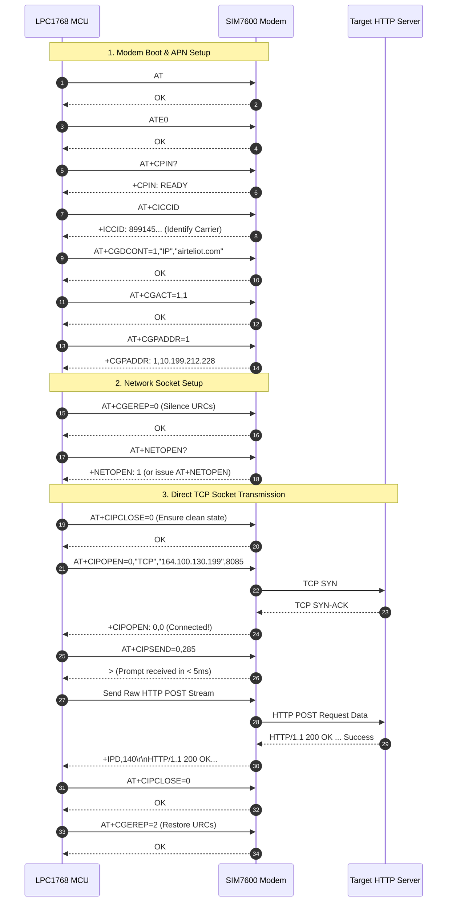

# LPC1768 & SIM7600 Porting & Protocol Integration Guide
**Authoritative Hardware, GPRS Protocol, Server Registry & Implementation Reference**  
*Origin: Spatika AIO9 Platform Architecture (Release v6.53)*

---

## 1. Executive Overview & Target Platform

This document serves as the master engineering specification to port the Spatika All-In-One (AIO) Automated Weather Station & Telemetry firmware from the ESP32 platform to the **NXP LPC1768 (ARM Cortex-M3)** microcontroller paired with the **SIMCom SIM7600 (4G LTE / 2G GSM)** cellular modem.

### Platform Comparison & Architectural Adjustments

| Architectural Aspect | Source Platform (ESP32) | Target Platform (NXP LPC1768) | Porting Strategy & Guidance |
| :--- | :--- | :--- | :--- |
| **CPU Core** | Xtensa Dual-Core 32-bit (240 MHz / 80 MHz) | ARM Cortex-M3 Single-Core (100 MHz) | Single-threaded state machine or lightweight FreeRTOS / CMSIS-RTOS tasks. |
| **SRAM** | 320 KB Internal SRAM | 64 KB Total SRAM (32 KB Local + two 16 KB AHB) | **Zero dynamic heap allocation (`malloc`/`free`)**. Use pre-allocated static buffers. |
| **Flash ROM** | 8 MB / 16 MB External SPI Flash | 512 KB On-chip Flash ROM | Keep codebase lean. Avoid bloated JSON parsers; use strict string/sscanf templates. |
| **Storage / FS** | SPIFFS / LittleFS on SPI Flash | SPI DataFlash (e.g. AT45DB / W25Q) or EEPROM | Use fixed-record circular ring buffers for backlog data and pointers. |
| **Cellular Engine** | Direct Layer-4 TCP Sockets (`AT+CIPOPEN`) | Direct Layer-4 TCP Sockets (`AT+CIPOPEN`) | **Identical AT Command Flow**. Transport Layer 4 bypasses modem HTTP bugs. |
| **UART Subsystem**| Hardware FIFO + FreeRTOS queues | LPC1768 UART0/1/2/3 with 16-byte FIFO + IRQ | Interrupt-driven Circular Ring Buffer (1024 or 2048 bytes). |
| **Real-Time Clock**| External DS1307 / internal RTC | Internal LPC1768 RTC or External DS1307 | Use battery-backed RTC with 15-minute slot interrupt alarms. |

---

## 2. Core Station Configurations & Identity Matrix

The firmware supports 4 discrete system configurations (`SYSTEM 0` to `SYSTEM 3`) across distinct networks (**KSNDMC**, **DES-BIHAR**, and **SPATIKA**).

### Station Identity Table

| System ID | Unit Name (`UNIT`) | Client / Network | Station Type | Sensor Suite | Primary HTTP Profile (`httpSet`) | Target Suffix |
| :--- | :--- | :--- | :--- | :--- | :---: | :---: |
| **SYSTEM 0** | `BIHAR_TRG` | DES-BIHAR (Bihar Govt) | **TRG** | Rain (Tipping Bucket) | Index 2 (`BIHAR_ACTIVE`) | `-N` (Nuvoton) / `-M` (Matrix) |
| **SYSTEM 0** | `KSNDMC_TRG` | KSNDMC (Karnataka) | **TRG** | Rain (Tipping Bucket) | Index 1 (`/trg_gprs/update_data_sit_v3`) | `-N` / `-M` |
| **SYSTEM 0** | `SPATIKA_GEN` | Spatika General | **TRG** | Rain (Tipping Bucket) | Index 6 (`/hmrtdas/trg_gen`) | `-N` / `-M` |
| **SYSTEM 1** | `KSNDMC_TWS` | KSNDMC | **TWS** | Temp, Humidity, Wind Spd, Wind Dir | Index 6 (`/tws_gprs/update_tws_data_v3`) | `-N` / `-M` |
| **SYSTEM 1** | `SPATIKA_TWS` | Spatika General | **TWS** | Temp, Humidity, Wind Spd, Wind Dir | Index 8 (`/tws_gprs/update_tws_data_v2`) | `-N` / `-M` |
| **SYSTEM 2** | `KSNDMC_ADDON`| KSNDMC | **TWS-RF** | Rain, Temp, Hum, Wind Spd, Wind Dir | Index 7 (`/tws_gprs/update_twsrf_data_v3`)| `-N` / `-M` |
| **SYSTEM 2** | `SPATIKA_ADDON`| Spatika General | **TWS-RF** | Rain, Temp, Hum, Wind Spd, Wind Dir | Index 9 (`/tws_gprs/update_twsrf_data_v2`)| `-N` / `-M` |
| **SYSTEM 3** | `SPATIKA_TWSRP`| Spatika General | **TWSRP** | Rain, Temp, Hum, Wind, Pressure | Index 11 (`/tws_gprs/update_data_twsrp_v2`)| `-N` / `-M` |

> [!IMPORTANT]
> **Station ID Padding Rule**: All station numeric IDs must be formatted as **6 characters**. If a 4-digit ID like `1920` is assigned, it must be left-padded with `00` (i.e. `001920`). Server-side parsers reject unpadded IDs.

---

## 3. Master Server & Endpoint Registry

### A. HTTP Telemetry Endpoints

| Target System | Host Domain | Direct IP | Port | URL Path | Format | Security Key | Notes |
| :--- | :--- | :--- | :---: | :--- | :---: | :--- | :--- |
| **Bihar Govt RTDAS (Primary)** | `rtdasbmsk.spatika.net` | `164.100.130.199` | `8085` | `/Home/UpdateTRGData` | `json` | `bmsk1234` | Govt portal for Bihar TRG |
| **Bihar INHS (New Server)** | `bmskinhs.spatika.net` | *(Modem DNS)* | `8085` | `/Home/UpdateTRGData` | `json` | `bmsk1234` | Target INHS server |
| **Bihar Spatika Fallback** | `rtdasbih.spatika.net` | `185.250.105.225` | `80` | `/trg_gprs/upload_bih_trg_data_new` | `json` | `bmsk12345` | Backup server |
| **KSNDMC TRG (v3 Modern)** | `rtdas.ksndmc.net` | `117.216.42.181` | `80` | `/trg_gprs/update_data_sit_v3` | `x-www-form-urlencoded` | `pse2420` | Current Karnataka TRG |
| **KSNDMC TRG (v2 Legacy)** | `rtdas.ksndmc.net` | `117.216.42.181` | `80` | `/trg_gprs/update_data_sit_v2` | `x-www-form-urlencoded` | `sit1040` | Legacy Karnataka TRG |
| **KSNDMC TWS (v3)** | `rtdas.ksndmc.net` | `117.216.42.181` | `80` | `/tws_gprs/update_tws_data_v3` | `x-www-form-urlencoded` | `climate4pTWS` | Karnataka AWS |
| **KSNDMC ADDON (v3)** | `rtdas.ksndmc.net` | `117.216.42.181` | `80` | `/tws_gprs/update_twsrf_data_v3` | `x-www-form-urlencoded` | `rfclimate5p13` | Karnataka AWS + Rain |
| **Spatika TWS (v2)** | `rtdas.spatika.net` | `144.91.104.105` | `80` | `/tws_gprs/update_tws_data_v2` | `x-www-form-urlencoded` | `climate4pTWS` | Spatika AWS |
| **Spatika ADDON (v2)** | `rtdas.spatika.net` | `144.91.104.105` | `80` | `/tws_gprs/update_twsrf_data_v2` | `x-www-form-urlencoded` | `rfclimate5p13` | Spatika AWS + Rain |
| **Spatika GEN TWS-RF** | `rtdas.spatika.net` | `89.32.144.163` | `80` | `/tws_gprs/twsrf_gen` | `x-www-form-urlencoded` | `wsgen2014` | Spatika General RF |
| **Spatika GEN TWSRP** | `rtdas.spatika.net` | `144.91.104.105` | `80` | `/tws_gprs/update_data_twsrp_v2` | `x-www-form-urlencoded` | `wsgen#2026` | Spatika Pressure Variant |
| **Spatika TRG Gen** | `rtdas1.spatika.net` | `89.32.144.163` | `80` | `/hmrtdas/trg_gen` | `x-www-form-urlencoded` | `sitgen100` | General Rain Gauge |
| **Telemetry & Health / OTA** | `devhlt.spatika.net` | `75.119.148.192` | `80` | `/health` | `json` | `spatika2026` | Health & Remote Commands |
| **Experimental SIT 1** | `104.211.5.142` | `104.211.5.142` | `3002` | `/esprain` | `json` | `sit` | Test endpoint |
| **Experimental SIT 2** | `104.211.5.142` | `104.211.5.142` | `3003` | `/dmc_trg_data` | `x-www-form-urlencoded` | `sit` | Test endpoint |

### B. FTP Backlog & Daily Archive Servers

| Service / Configuration | Hostname / IP | Port | Username | Password | Notes / Format |
| :--- | :--- | :---: | :--- | :--- | :--- |
| **Bihar Daily Archive** | `ftphbih.spatika.net` | `21` | `trg_desbih_csvdt` | `rf24hrcsv2021` | Daily 8:30 AM CSV report |
| **Bihar General Backup** | `89.32.144.163` | `21` | `dota_bih` | `airdata2024` | General FTP backup |
| **KSNDMC TWS (S1)** | `ftp1.ksndmc.net` | `21` | `tws_spatika_v2` | `twssp#987` | `.kwd` files (57 bytes/rec) |
| **KSNDMC ADDON (S2)** | `ftp1.ksndmc.net` | `21` | `twsrf_spatika_v2`| `sittao#10` | `.kwd` files (63 bytes/rec) |
| **KSNDMC TRG Daily** | `ftp1.ksndmc.net` | `21` | `trg_spatika_v2@ksndmc.net`| `trgsp#123` | Daily summary archive |
| **DMC General Fallback**| `89.32.144.163` | `21` | `dota_dmc` | `airdata2016` | Standard non-daily Karnataka |
| **Spatika TWS (S1)** | `ftp.spatika.net` | `21` | `tws_gen` | `spgen123` | `.swd` files |
| **Spatika TWS-RF (S2)** | `ftp.spatika.net` | `21` | `twsrf_gen` | `spgen123` | `.swd` files (63 bytes/rec) |
| **Spatika TWSRP** | `ftp.spatika.net` | `21` | `twsrp_gen` | `pressure2016` | Pressure variant archive |

---

## 4. Exact Payload Specifications & Formats

### A. Bihar TRG (JSON Format)
* **Target Endpoint**: `http://rtdasbmsk.spatika.net:8085/Home/UpdateTRGData` or `http://bmskinhs.spatika.net:8085/Home/UpdateTRGData`
* **Content-Type**: `application/json`
* **Specimen String**:
  ```json
  {"StnNo":"001920","DeviceTime":"2026-04-01 10:00:00","RainDP":"000.0","RainCuml":"001.2","BatVolt":"04.1","SigStr":"-051","ApiKey":"bmsk1234"}
  ```
* **Field Formatting**:
  - `StnNo`: 6-character zero-padded string (`%s`).
  - `DeviceTime`: `YYYY-MM-DD HH:MM:SS` (must end with `:00` for exact 15-min slots).
  - `RainDP`: Width 5, 1 decimal (`%05.1f` -> e.g. `000.0`) representing 15-minute incremental rainfall.
  - `RainCuml`: Width 5, 1 decimal (`%05.1f` -> e.g. `001.2`) representing 24-hr cumulative rainfall.
  - `BatVolt`: Width 4 (`%04.1f` -> e.g. `04.1`).
  - `SigStr`: Width 4 signed integer (`%04d` -> e.g. `-051`).
  - `ApiKey`: `bmsk1234`

### B. KSNDMC TRG (URL-Encoded Format)
* **Target Endpoint**: `http://rtdas.ksndmc.net/trg_gprs/update_data_sit_v3`
* **Content-Type**: `application/x-www-form-urlencoded`
* **Specimen String**:
  ```text
  stn_id=001921&rec_time=2026-04-01,10:00&rainfall=000.25&signal=-051&key=pse2420&bat_volt=04.1&bat_volt1=04.1
  ```
* **Field Formatting**:
  - `stn_id`: 6-character string (`001921`).
  - `rec_time`: `YYYY-MM-DD,HH:MM` (comma delimited, no seconds).
  - `rainfall`: Width 5, 2 decimals (`%05.2f` -> `000.25`).
  - `signal`: Width 4 signed integer (`%04d` -> `-051`).
  - `key`: `pse2420`.
  - `bat_volt`, `bat_volt1`: Duplicated battery voltage strings (`04.1`).

### C. KSNDMC TWS (AWS URL-Encoded Format)
* **Target Endpoint**: `http://rtdas.ksndmc.net/tws_gprs/update_tws_data_v3`
* **Content-Type**: `application/x-www-form-urlencoded`
* **Specimen String**:
  ```text
  stn_no=001802&rec_time=2026-09-11,08:30&temp=028.4&humid=067.7&w_speed=00.0&w_dir=344&signal=-51&bat_volt=04.02&key=climate4pTWS
  ```
* **Field Formatting**:
  - `stn_no`: 6-character station ID (`001802`).
  - `rec_time`: `YYYY-MM-DD,HH:MM`.
  - `temp`: Temperature in °C (`%05.1f` or `%04.1f` -> `028.4`).
  - `humid`: Relative humidity in % (`%05.1f` -> `067.7`).
  - `w_speed`: Average wind speed in m/s (`%04.1f` -> `00.0`).
  - `w_dir`: Wind direction in degrees (`%d` -> `344`).
  - `signal`: CSQ RSSI in dBm (`-51`).
  - `bat_volt`: Battery voltage (`%05.2f` -> `04.02`).
  - `key`: `climate4pTWS`.

### D. KSNDMC ADDON / TWS-RF (URL-Encoded Format)
* **Target Endpoint**: `http://rtdas.ksndmc.net/tws_gprs/update_twsrf_data_v3`
* **Content-Type**: `application/x-www-form-urlencoded`
* **Specimen String**:
  ```text
  stn_no=1063&rec_time=2026-09-15,14:45&rainfall=0.5&temp=23.6&humid=89.5&w_speed=1.5&w_dir=234&signal=-67&bat_volt=12.5&key=rfclimate5p13
  ```

### E. Fixed-Width Record Rules for FTP Files
Many legacy ingest parsers use byte-offset column extraction rather than delimiter parsing. One missing digit or sign invalidates the entire file:

1. **KSNDMC TWS FTP Record (`.kwd`)**:
   - **Total Length**: **Exactly 57 Bytes** (including `\r\n`).
   - **Specimen**: `003736;2025-08-21,10:00;024.6;100.0;00.0;021;-079;04.43\r\n`
   - Battery must be precision 2 (`%05.2f`). If sent as `04.4`, total length is 56 bytes and server drops it.

2. **TWS-RF / ADDON FTP Record (`.swd` or `.kwd`)**:
   - **Total Length**: **Exactly 63 Bytes** (including `\r\n`).
   - **Specimen**: `000297;2025-08-21,09:45;000.0;+26.8;070.7;00.2;260;-079;13.58\r\n`
   - Fixed Column Positions:
     - Character 48: Wind Direction (`260`)
     - Character 52: Signal Strength (`-079`)
     - Character 57: Battery Voltage (`13.58`)

---

## 5. SIM7600 GPRS Execution Flow (Direct Layer-4 TCP Sockets)

### Why High-Level Modem HTTP (`AT+HTTPINIT`) is Banned
On SIMCom A7672S / SIM7600 modules, the internal high-level HTTP client has fatal firmware flaws:
1. `AT+HTTPDATA` returns `ERROR` instead of `DOWNLOAD` prompt if asynchronous URCs (`+CGEV`) arrive during handshake.
2. The internal buffer accumulates data across sessions, corrupting sequential downloads.
3. Explicit `AT+HTTPPARA="CID",1` is rejected on some firmware builds.

**Solution**: Use standard **Direct Layer-4 3GPP TCP Sockets (`AT+NETOPEN`, `AT+CIPOPEN`, `AT+CIPSEND`, `AT+CIPCLOSE`)**.



---

### Step-by-Step AT Command Reference

#### Stage 1: Hardware Synchronization & Silence
1. `AT` -> Wait for `OK` (timeout 1000ms).
2. `ATE0` -> Disable command echoing (avoids circular buffer pollution).
3. `AT+CGEREP=0` -> **Crucial**: Silence GPRS Event URCs so asynchronous carrier events do not corrupt UART frames.
4. `AT+CREG=0` and `AT+CEREG=0` -> Silence registration URCs during data transfer.

#### Stage 2: SIM & Carrier Discovery
1. `AT+CPIN?` -> Must return `+CPIN: READY`. Retry up to 15 times with 1-second delay for cold boot SIM wake.
2. `AT+CICCID` (or `AT+CCID`) -> Returns 20-digit ICCID string.
3. **Smart APN Matching Table**:
   - `899145...` or `899116...` or `899110...` -> **Airtel M2M / IoT** -> APN: `airteliot.com`
   - Other Airtel SIMs -> **Airtel Commercial** -> APN: `airtelgprs.com`
   - `899186...` or IMSI starting with `404/405` (BSNL) -> **BSNL** -> APN: `bsnlnet`
   - `899187...` -> **Jio 4G** -> APN: `jionet`

#### Stage 3: Cellular Registration Polling
1. Issue `AT+CEREG?` (LTE) and `AT+CREG?` (GSM 2G).
2. Accept status `1` (Registered home) or `5` (Registered roaming).
3. **4G-First Policy with 2G Fallback**:
   - Start in 4G mode: `AT+CNMP=38`.
   - Poll `AT+CEREG?` every 1s for up to 5 seconds.
   - If not registered by retry 5, issue `AT+CNMP=13` (GSM-only). Airtel 2G and BSNL 2G latch immediately onto GSM.
4. Issue `AT+CSQ` -> Extract RSSI (e.g. `+CSQ: 21,99`). Calculate dBm: `dBm = 2 * RSSI - 113` (RSSI 21 -> -71 dBm).

#### Stage 4: PDP Context & Bearer Activation
1. Read current context: `AT+CGDCONT?`.
2. Define context profile on CID 1:
   - For standard IPv4: `AT+CGDCONT=1,"IP","<APN>"`
   - For Jio: `AT+CGDCONT=1,"IPV4V6","jionet"`
3. Delay 800ms to allow modem flash commit.
4. Activate Context 1: `AT+CGACT=1,1` (Timeout: 25,000ms).
   - If `CGACT` fails, issue `AT+CGATT=1`, wait 1.5s, and retry `AT+CGACT=1,1`.
5. Verify Assigned IP Address: `AT+CGPADDR=1`.
   - Response: `+CGPADDR: 1,"10.x.x.x"`.
   - **Trap**: If IP is `0.0.0.0` or empty, the bearer is a zombie. Reset with `AT+CFUN=0` followed by `AT+CFUN=1`.

#### Stage 5: Transport Layer Network Activation
1. Check socket engine state: `AT+NETOPEN?`.
2. If response is not `+NETOPEN: 1`, send `AT+NETOPEN`.
3. Wait for `+NETOPEN: 1` or `OK` (timeout 5000ms).

#### Stage 6: Direct TCP Socket HTTP POST
1. Always close stale socket first: `AT+CIPCLOSE=0`.
2. Construct Raw HTTP/1.1 Wire Stream in RAM buffer:
   ```http
   POST /Home/UpdateTRGData HTTP/1.1\r\n
   Host: rtdasbmsk.spatika.net\r\n
   Content-Type: application/json\r\n
   Content-Length: 141\r\n
   Connection: close\r\n
   \r\n
   {"StnNo":"001920","DeviceTime":"2026-04-01 10:00:00","RainDP":"000.0","RainCuml":"001.2","BatVolt":"04.1","SigStr":"-051","ApiKey":"bmsk1234"}
   ```
3. Calculate exact length `rawLen = strlen(rawHttp)`.
4. Open TCP connection to target IP (or domain):
   - Command: `AT+CIPOPEN=0,"TCP","<Target_Host>",<Port>`
   - Example: `AT+CIPOPEN=0,"TCP","164.100.130.199",8085`
   - Wait for `+CIPOPEN: 0,0` (timeout 15,000ms).
5. Send command to trigger prompt:
   - `AT+CIPSEND=0,<rawLen>`
   - Wait for `>` character (timeout 5000ms). Prompt returns in < 5ms.
6. Write the raw HTTP byte stream directly to the UART:
   - Send `rawLen` bytes.
7. Receive server response:
   - Wait for `+IPD` or string `200 OK` or `Success` (timeout 15,000ms).
   - Once confirmed, close socket cleanly: `AT+CIPCLOSE=0`.

---

## 6. Critical Operational Rules & Hidden Traps

### Rule 1: The Spatika 62-Second Slot Boundary Guard
* **The Server Quirk**: The Spatika and RTDAS aggregate servers strictly reject any packet received less than 62 seconds after the slot boundary (e.g. at 08:30:15, elapsed time is 15s < 62s; server responds with `"Rejected"`).
* **Firmware Implementation**:
  ```c
  int elapsed_seconds = ((current_min % 15) * 60) + current_sec;
  if (elapsed_seconds < 62) {
      int hold_seconds = 62 - elapsed_seconds;
      delay_ms(hold_seconds * 1000);
  }
  ```

### Rule 2: Socket ID Isolation for OTA (`AT+CIPOPEN=1`)
* Telemetry and Health check-ins use **Socket 0** (`AT+CIPOPEN=0`).
* Over-The-Air (OTA) binary downloads **MUST use Socket 1** (`AT+CIPOPEN=1`).
* **Why**: When Socket 0 closes, cellular carrier NAT (Airtel/BSNL) holds the connection in `TIME_WAIT`. If OTA immediately attempts to reuse Socket 0, the tower sends an immediate TCP `RST` or `+IPCLOSE: 0,1`.

### Rule 3: Post-Telemetry 3000ms Carrier NAT Breather
* Always enforce a **3000ms to 5000ms delay** after closing the telemetry socket before initiating another network connection (such as OTA download or switching between primary server and health server).

### Rule 4: Zero-Drop Raw Binary Passthrough on `+IPD`
* `+IPD` frames arrive from the SIM7600 as `+IPD,<len>:<data>` or `+IPD,<link_id>,<len>:<data>`.
* **The Trap**: If your UART parser peeks or drops `\r` (`0x0D`) or `\n` (`0x0A`) after the colon, any binary chunk in an OTA image whose first byte is `0x0D` or `0x0A` will have that byte stripped. This shifts memory addresses and causes checksum verification failures.

---

## 7. NXP LPC1768 Porting & Driver Guidelines

### A. Memory Architecture (64 KB SRAM Budgeting)
The LPC1768 contains:
* `32 KB` Main IRAM (0x10000000 - 0x10007FFF): Application variables, stack, and active HTTP buffers.
* `16 KB` AHB SRAM Bank 0 (0x2007C000 - 0x2007FFFF): Dedicated UART RX/TX Circular Ring Buffers.
* `16 KB` AHB SRAM Bank 1 (0x20080000 - 0x20083FFF): Backlog queue record scratchpad.

#### Static Buffer Allocations (No `malloc`):
```c
#define UART_RING_BUF_SIZE    2048
#define RAW_HTTP_BUF_SIZE     512
#define PAYLOAD_BUF_SIZE      300
#define RESPONSE_BUF_SIZE     2048

static uint8_t uart_rx_ring[UART_RING_BUF_SIZE] __attribute__((section(".ahb_sram0")));
static char    raw_http_buf[RAW_HTTP_BUF_SIZE];
static char    payload_buf[PAYLOAD_BUF_SIZE];
static char    modem_resp_buf[RESPONSE_BUF_SIZE];
```

### B. LPC1768 UART Driver (Interrupt-Driven Ring Buffer)
Configure UART (e.g., UART3 on P0.0/TXD3 and P0.1/RXD3) with 16-byte FIFO enabled:
1. Baud Rate: `115200` baud (8-N-1).
2. Enable RX Interrupt (`IER_RBR`).
3. Inside `UART3_IRQHandler`:
   - Read `U3IIR` status register.
   - While `U3LSR & 0x01` (Data Ready), push byte into `uart_rx_ring`.
   - Update atomic write pointer.

### C. Power Management & 15-Minute Slot Sleep Cycle
1. After data transmission is completed:
   - Send `AT+CPOF` to gracefully shut down the SIM7600 RF stack.
   - Pull SIM7600 `PWRKEY` pin LOW and cut external 4.2V VBAT regulator via P-channel MOSFET if hardware supports it.
2. Configure LPC1768 Internal RTC:
   - Set RTC alarm interrupt for the next 15-minute slot (`00`, `15`, `30`, `45` minutes).
3. Enter Deep Sleep Mode:
   - Execute CMSIS instruction `__WFI()` (Wait For Interrupt) in Power-Down mode (`SC_PCON = 0x00`).
   - Power consumption in Power-Down mode is **< 15 µA**.

---

## 8. Summary Checklist for LPC1768 Firmware Developer

- [ ] Configure UART with a **2048-byte interrupt ring buffer** at 115200 baud.
- [ ] Implement `waitForResponse(pattern, timeout_ms)` using non-blocking millisecond tick timers.
- [ ] Integrate ICCID reading (`AT+CICCID`) and auto-select APN (`airteliot.com` / `bsnlnet`).
- [ ] Enforce **Direct Layer-4 TCP Sockets (`AT+CIPOPEN=0,"TCP",...`)** — avoid `AT+HTTPINIT`.
- [ ] Left-pad Station IDs with `00` to exactly 6 digits.
- [ ] Implement the **62-second slot hold guard** for Spatika/Bihar servers.
- [ ] Set Content-Type to `application/json` for Bihar and `application/x-www-form-urlencoded` for KSNDMC.
- [ ] Use `AT+CGEREP=0` to silence modem URC noise before TCP socket operations.
- [ ] Enforce 3000ms silence breather before host switching or OTA socket open.
- [ ] Verify zero dynamic heap allocation in all GPRS transmission loops.

